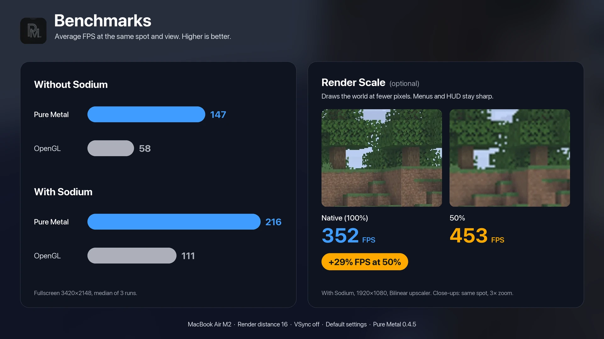

# Pure Metal

A native Metal renderer for Minecraft on Apple Silicon Macs. Same visuals as vanilla, rendered through Apple's Metal API instead of OpenGL. Works with Sodium.

- Terrain LOD for extra FPS at long render distances
- Optional Render Scale with temporal upscaling and an Auto mode
- Experimental Metal 4 mode (macOS 26+)
- Experimental Smooth Frame Pacing with VSync
- Experimental Distant Horizons support
- A Pure Metal line on the F3 screen for bug reports


## Requirements

- macOS 14 or newer on Apple Silicon (tested on M2). The optional Metal 4 mode needs macOS 26.
- Minecraft 26.3 with Fabric Loader 0.19+
- Java 25
- Sodium (optional)

Iris and other shader mods are not supported.

## Known limitations

- Experimental. Tested on an Apple M2 only; other Macs should work but are untested.
- Metal 4 mode is optional and slower or less stable than Metal 3 for now.
- Iris and other shader mods are not supported.
- Pure Metal is an independent project and is not affiliated with Mojang, Microsoft or Apple.

## Install

Download the jar from the releases page and put it in your `mods` folder. Leave Graphics API on Default.

## Distant Horizons

**Distant Horizons** is experimental in **Pure Metal 0.4.2**. Use DH **3.3.4** and add this to your launcher's JVM arguments:

```
-Dpuremetal.experimentalDistantHorizons=true
```

Keep DH's rendering engine on **AUTO**. Distant terrain may take time to generate. Not supported with Iris. Remove the JVM argument and restart to turn it off.


## Build

```
./gradlew build
```

Needs Xcode 26 or newer, or its command line tools (the Objective-C bridge is built with the system `clang` against the macOS 26 SDK; the result still runs on macOS 14+) and a Java 25 toolchain. The jar ends up in `build/libs`.

## Benchmarking



**Pure Metal vs mcopt (1920x1080 window)**

| Renderer | Avg FPS | 1-in-200 slowest frame (p99.5) |
| --- | --- | --- |
| Pure Metal + Sodium, 50% scale | <strong>465</strong> | <strong>2.8 ms</strong> |
| mcopt | 464 | 4.5 ms |
| Pure Metal + Sodium | 298 | 4.2 ms |
| Pure Metal | 247 | 4.9 ms |
| OpenGL (no Sodium) | 91 | 20.0 ms |

*Separate test from the benchmark above: one 20-second flight per renderer, same world and path. Pure Metal 0.4.2, Sodium 0.9.3-beta.1, mcopt 0.3.0-alpha.2.*

`tools/bench.py` compares graphics APIs on your own Mac:

```
python3 -I tools/bench.py <tag> default opengl
```

Results depend on the Mac, the world and the render distance, so compare runs on the same machine only. Setup, options and a note on Terrain LOD are in [docs/BENCHMARKING.md](docs/BENCHMARKING.md).

## Docs

- [Design notes](docs/DESIGN.md)
- [Benchmarking](docs/BENCHMARKING.md)
- [Changelog](CHANGELOG.md)

## Issues

Bug reports go to the issue tracker. Include the Pure Metal line from F3 and `latest.log`.

## License

Apache License 2.0, see [LICENSE](LICENSE).
